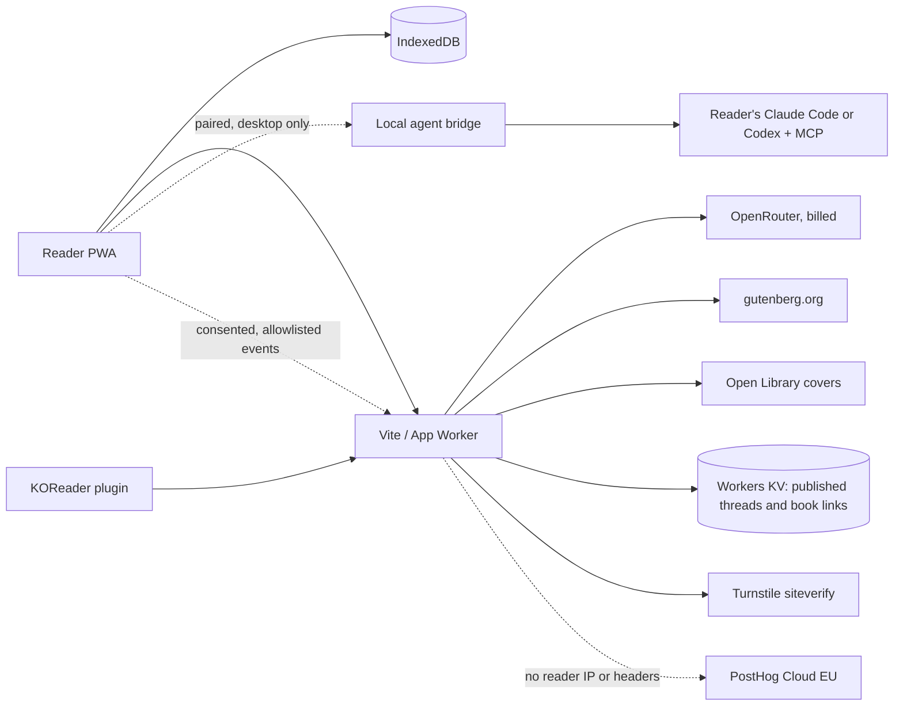

# Architecture

## Goal

A mobile-friendly EPUB reader where highlighting a passage starts an AI
conversation seeded with the book's metadata, the reader's chapter and
position, and the surrounding text. Conversations persist per book, and a
rolling per-book memory makes new chats aware of earlier ones.

## Requirements

- Reading, highlights, and stored conversations work offline.
- All reader data stays on the device in IndexedDB, except a thread or a book
  card the reader explicitly publishes as a link.
- Chat works for any visitor with no signup or API key.
- The KOReader plugin can ask about a selection on an e-reader and hand its
  highlights to the PWA.
- Product telemetry is consent-gated by region, allowlisted, and anonymous,
  sent through the Worker's relay, and off unless the Worker has a project key
  (decision 0008).

## Constraints

- DRM-free EPUBs only. EPUB scripts stay disabled.
- Book text, including EPUB chapter names and metadata, is untrusted and stays
  fenced in model prompts.
- Every hosted chat request is billed; the provider credit cap is the ceiling.
- iOS Safari limits IndexedDB storage more than Android Chrome.

## Non-goals

- A native app or app-store distribution.
- Accounts, or server-side storage of books and conversations beyond threads
  and book cards (title, author, Gutenberg id, cover) a reader explicitly
  publishes. EPUB files are never uploaded.
- Syncing memory between the PWA and KOReader.
- Telemetry that identifies readers or carries their content: no person
  profiles, persistent ids, session recording, or autocapture (decision 0008).

## Service and data boundaries

Deploy adapters share `shared/relay.ts`, `shared/gutenberg.ts` and
`shared/covers.ts`; they must not import browser modules.

A reader can have chat answered by their own Claude Code or Codex CLI and the
MCP servers they allow, instead of OpenRouter. In development, `CHAT_AGENT`
makes the Vite server do it at `/api/chat` (decision 0009). From the hosted
app, a reader pairs in Settings with a local bridge, `npm run agent-bridge`,
which the PWA calls at `http://127.0.0.1:47615` (decision 0010,
[agent-bridge.md](agent-bridge.md)). Both run the same Node-only handler in
`dev/`, which the Worker never loads. A bridge started with `--save-dir` also
keeps a one-way Markdown copy of each thread in that folder (decision 0011);
IndexedDB stays the source of truth.

## Local storage schema

`src/db/types.ts` defines records; `src/db/db.ts` owns Dexie versions 1–6.
Books own highlights, conversations, and memory. Conversations own messages.
Compound indexes group children by book/conversation plus creation/update time.
Version 2 repairs old digest delimiters, version 3 adds archives, and version 4
adds external-id indexes for idempotent KOReader import, and version 5 drops the
removed audiobook token and position from settings. Do not rewrite migration
history. Use transactions and bulk `anyOf` lookups instead of per-row queries.
Deletion cascades; archiving removes EPUB bytes but preserves notes and file hash.

HTTP contracts are `docs/api.openapi.yml`. Lua-to-reader handoff validation is
`src/lib/koreader.ts`, exercised with synthetic fixtures and the real Lua VM.

## External services

Chat sends the user-selected context to the chosen model provider. Offline
reading and normal tests need no external services.
When the Worker has a PostHog key and the reader's preference allows, the PWA
sends allowlisted product events to the Worker's relay, which checks them again
and forwards them to PostHog Cloud without the reader's IP address or headers
(`src/lib/telemetry.ts`, `shared/telemetryRelay.ts`, [telemetry.md](telemetry.md)):
event names, enum properties, the app version, and a tab-session id. Never book content, titles, notes, chats, or URLs. Worker
metrics are fixed operation names, status codes, and numeric durations. Publishing a thread sends its snapshot to
the Worker, and sharing a book sends its title, author, Gutenberg id and a
re-encoded cover. Both load Cloudflare Turnstile in their dialog only. A local storage-loss log is shared only
when the reader submits a prefilled GitHub issue from Settings.

## Decision index

Record consequential choices by copying [the template](decisions/TEMPLATE.md)
to `decisions/NNNN-short-title.md` and linking it here.

- [0001 Build a PWA on epub.js, not a native Android app](decisions/0001-pwa-with-epubjs.md)
- [0002 Route chat through a hosted relay that holds the key](decisions/0002-hosted-chat-relay.md)
- [0003 Match books by EPUB file hash, not title](decisions/0003-match-editions-by-file-hash.md)
- [0004 Keep a bounded rolling digest per book as chat memory](decisions/0004-rolling-book-memory.md)
- [0005 KOReader keeps its own digest and folds it lazily](decisions/0005-koreader-device-digest.md)
- [0006 Publish shared threads at unlisted links](decisions/0006-public-thread-links.md)
- [0007 Share books at links that add them for the recipient](decisions/0007-shared-book-links.md)
- [0008 Send privacy-first product telemetry to PostHog Cloud](decisions/0008-privacy-first-telemetry.md)
- [0009 Let the dev server answer chat with a local agent CLI](decisions/0009-local-agent-chat.md)
- [0010 Let the hosted app reach a local agent through a paired bridge](decisions/0010-local-agent-bridge.md)
- [0011 Mirror threads to Markdown files through the bridge](decisions/0011-mirror-threads-to-disk.md)
- [0013 Allow named tools of an MCP server, not only whole servers](decisions/0013-per-tool-mcp-allowlist.md)
